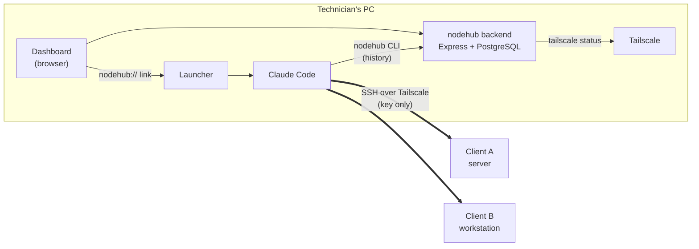

<div align="center">

# nodehub

**Remote helpdesk for your clients' PCs, powered by Tailscale and Claude Code.**

One dashboard with every client machine, organised by client. Pick a machine, and Claude Code
connects to it over SSH to diagnose, fix and check for malware, while every session is recorded
for the whole team.

</div>

---

## Why

Supporting many small clients usually means remote-desktop sessions, interrupting the user, and
knowledge that lives in one technician's head. nodehub changes that:

- **No screen sharing, no ports open.** Client PCs join a private [Tailscale](https://tailscale.com)
  network and accept SSH only from the support team's devices.
- **Claude Code does the legwork.** It runs the diagnostics, explains what it found and only changes
  things after the technician approves (rules in [`CLAUDE.md`](CLAUDE.md)).
- **Nothing is forgotten.** Each session (problem, diagnosis, actions, result) is stored with the
  machine and the technician, searchable by everyone.

## Features

| | |
|---|---|
| **Dashboard** | Every client machine grouped by client, with live online/offline status from Tailscale. Built for many clients: collapsible groups, search, status filters and sorting. |
| **Quick search** | Ctrl+K on any page: type a machine's name, press Enter, and Claude opens on it. |
| **One-click sessions** | *Open in Claude* opens a terminal with Claude Code already connected to the machine. |
| **Zero-typing onboarding** | Download the installer, run it on the client PC, pick the client in the dashboard. |
| **History** | Session log per machine and across all clients, grouped by day, with search and filters. |
| **Machine profiles** | Role, hardware, important software and quirks, kept up to date by Claude. |
| **English or Portuguese** | One switch for the team: dashboard, records written by Claude, CLI and client installer. Each person can also pick their own dashboard language. |
| **Team accounts** | Users with Admin / Technician roles. PCs connect to an account with one click in the browser, no tokens to copy. |
| **API** | Documented REST API with Swagger at `/api/docs`. |

## How it works



1. A client PC runs the **installer** once: it joins the tailnet with a client tag and gets an SSH
   server that only accepts the technicians' keys.
2. The machine appears in the **dashboard**; a technician assigns it to a client.
3. When the client needs help, the technician clicks **Open in Claude**, describes the problem, and
   Claude works on the machine over SSH, asking before any change.
4. At the end Claude records the **session** and updates the machine **profile**.

## Quick start

> Requirements: Windows, Node.js 20+, Docker Desktop, Tailscale, Claude Code.

```powershell
git clone <your fork of this repository> nodehub
cd nodehub
copy backend\.env.example backend\.env     # then fill in JWT_SECRET, CLIENT_TAG, TAILSCALE_AUTHKEY
.\launcher\register-protocol.ps1           # once per technician PC
.\start.cmd                                # starts PostgreSQL, builds and opens the dashboard
```

The first run creates an `admin` user and prints its password. Full walkthrough, including the
Tailscale setup: **[docs/installation.md](docs/installation.md)**.

## Documentation

| Guide | |
|---|---|
| [Installation](docs/installation.md) | Tailscale (tags, ACL, auth key), SSH keys, technician PC, first run |
| [Configuration](docs/configuration.md) | Every setting in `backend/.env` |
| [Using the dashboard](docs/usage.md) | Machines, adding clients, history, users, connected PCs |
| [Helpdesk sessions with Claude](docs/helpdesk-sessions.md) | How a session runs, what Claude may and may not do |
| [nodehub CLI](docs/cli.md) | The command-line tool Claude uses to read and record history |
| [Client installer](docs/client-installer.md) | What it changes on a client PC, and how to undo it |
| [Architecture](docs/architecture.md) | Components, data model, request flows |
| [Security](docs/security.md) | Threat model and the protections in place |
| [API](docs/api.md) | Endpoints and error codes |
| [Development](docs/development.md) | Stack, project layout, scripts, tests, conventions |
| [Troubleshooting](docs/troubleshooting.md) | Common problems and fixes |
| [Roadmap](docs/roadmap.md) | What's next |

## Tech stack

Backend: Node.js, Express, TypeScript, Zod, Prisma, PostgreSQL, Winston, Swagger.
Frontend: React, Vite, TypeScript, Tailwind CSS.
Follows [fullstack-ts-standards](https://github.com/MiguelSousa369/fullstack-ts-standards).
