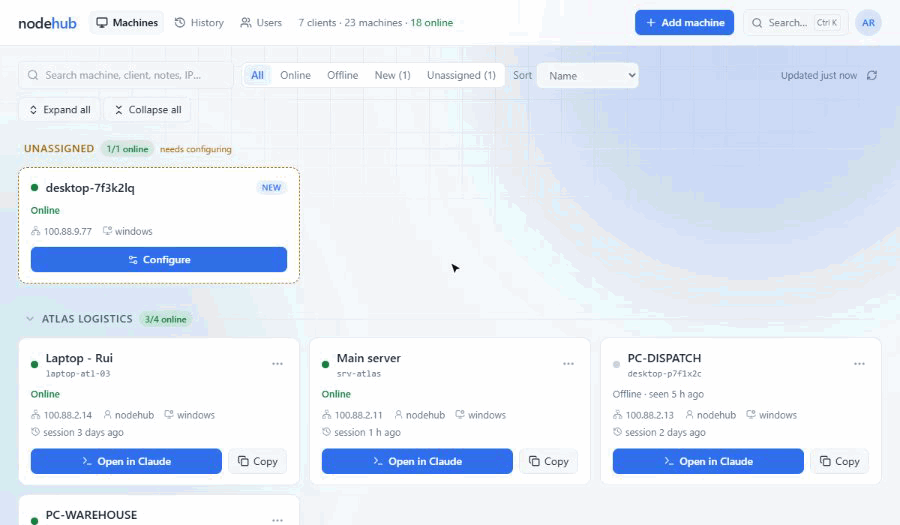
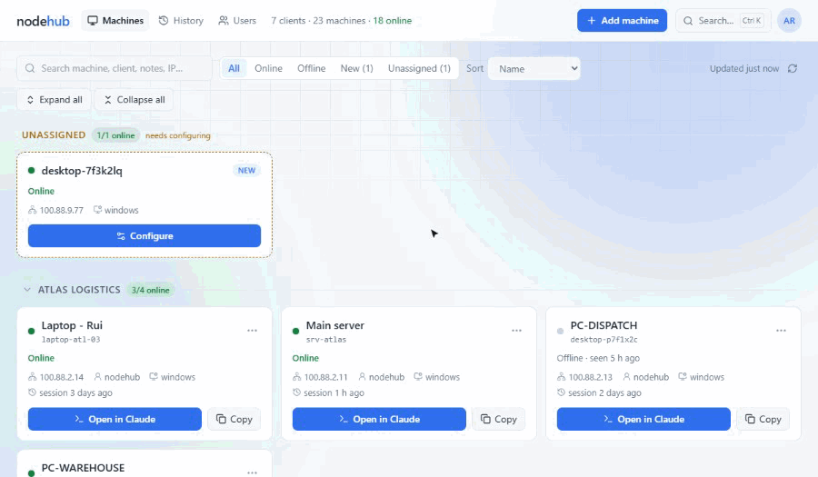
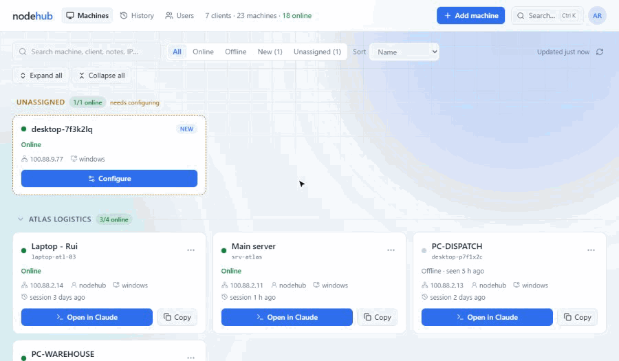
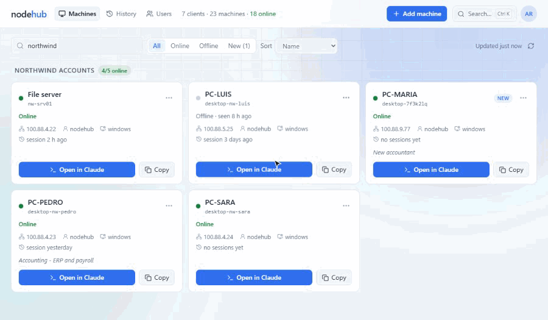
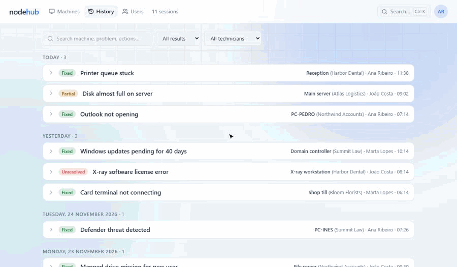
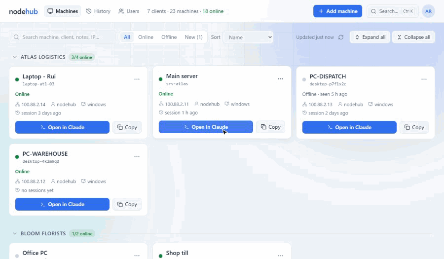
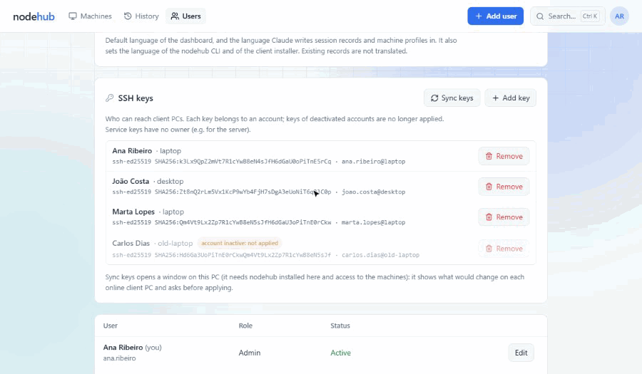
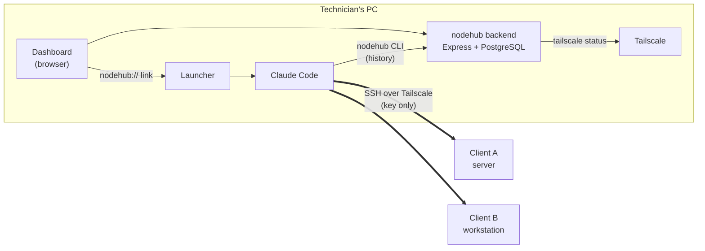

<div align="center">

<picture>
  <source media="(prefers-color-scheme: dark)" srcset="docs/media/logo-dark.svg">
  
</picture>

**Remote helpdesk for your clients' PCs, powered by Tailscale and Claude Code.**

One dashboard with every client machine, organised by client. Pick a machine, and Claude Code
connects to it over SSH to diagnose, fix and check for malware, while every session is recorded
for the whole team.

</div>

---

## Why

Supporting many small clients usually means remote-desktop sessions, interrupting the user, and
knowledge that lives in one technician's head. nodehub changes that:

- **No screen sharing, no ports open.** Client PCs join a private [Tailscale](https://tailscale.com)
  network and accept SSH only from the support team's devices.
- **Claude Code does the legwork.** It runs the diagnostics, explains what it found and only changes
  things after the technician approves (rules in [`CLAUDE.md`](CLAUDE.md)).
- **Nothing is forgotten.** Each session (problem, diagnosis, actions, result) is stored with the
  machine and the technician, searchable by everyone.

## See it in action

*Demo data: the clients, people and PCs below are fictional.*

**Every client machine, grouped by client.** Search, filter by status, and see what's online.



**Quick search.** Ctrl+K on any page, type a name, Enter: Claude opens on that machine.



**A new PC shows up.** Pick the client and give it a friendly name.



**Each machine's profile and history**, recorded by Claude at the end of every session.



**History across all clients**, grouped by day and filterable.



**Light or dark, English or Portuguese.**



**SSH keys belong to accounts.** A deactivated technician's key stops being applied; *Sync keys*
updates every client PC.



## Features

| | |
|---|---|
| **Dashboard** | Every client machine grouped by client, with live online/offline status from Tailscale. Built for many clients: collapsible groups, search, status filters and sorting. |
| **Quick search** | Ctrl+K on any page: type a machine's name, press Enter, and Claude opens on it. |
| **One-click sessions** | *Open in Claude* opens a terminal with Claude Code already connected to the machine. |
| **Zero-typing onboarding** | Download the installer, run it on the client PC, pick the client and a friendly name (e.g. *PC-PEDRO*). New machines are marked *New*. |
| **History** | Session log per machine and across all clients, grouped by day, with search and filters. Claude can correct a session after recording it. |
| **Machine profiles** | Role, hardware, important software and quirks, kept up to date by Claude. |
| **English or Portuguese** | One switch for the team: dashboard, records written by Claude, CLI and client installer. Each person can also pick their own dashboard language. |
| **Team accounts** | Users with Admin / Technician roles. PCs connect to an account with one click in the browser, no tokens to copy. |
| **SSH key management** | Each technician adds their own key; deactivating an account takes its keys off every client PC with one *Sync keys* click. |
| **Office server** | Run it on one server and open it at its IP from every PC ([guide](docs/server.md)). |
| **Secure by default** | Reviewed against the OWASP Top 10: audit log, sign-in lockout, least-privilege PC tokens ([security](docs/security.md)). |
| **API** | Documented REST API with Swagger at `/api/docs`. |

## How it works



1. A client PC runs the **installer** once: it joins the tailnet with a client tag and gets an SSH
   server that only accepts the technicians' keys.
2. The machine appears in the **dashboard**; a technician assigns it to a client.
3. When the client needs help, the technician clicks **Open in Claude**, describes the problem, and
   Claude works on the machine over SSH, asking before any change.
4. At the end Claude records the **session** and updates the machine **profile**.

## Two ways to run it

| | **One PC** | **Office server** |
|---|---|---|
| For | Trying it out, or a single technician | A team: everyone shares the same machines and history |
| Dashboard + database | On your PC, at `http://127.0.0.1:8737` | On the server, at its IP, e.g. `http://192.168.1.50:8737` |
| Who opens the dashboard | Only that PC | Every PC on the office network |
| Claude Code (helpdesk sessions) | On that PC | On each technician's PC |
| Guide | [Installation](docs/installation.md) | [Installation](docs/installation.md) steps 1-3, then [Office server](docs/server.md) |

In both modes, Claude always connects to client PCs **from the technician's PC**, with that
technician's SSH key; the server only keeps the dashboard and the data.

## Quick start (one PC)

This sets up the **one PC** mode, the quickest way to try nodehub. For a team, see
[Office server](docs/server.md).

You need, on that PC: **Windows 10/11**, [Node.js](https://nodejs.org) 20+,
[Docker Desktop](https://www.docker.com/products/docker-desktop/) (running),
[Tailscale](https://tailscale.com/download), [Claude Code](https://docs.anthropic.com/claude-code)
and Git.

**1. Get the code**

```powershell
git clone https://github.com/MiguelSousa369/nodehub.git
cd nodehub
```

**2. Create the settings file**

```powershell
copy backend\.env.example backend\.env
```

Only one setting is required to start: `JWT_SECRET`, a random secret that signs the logins.
Generate one and paste it after `JWT_SECRET=` in `backend\.env`:

```powershell
node -e "console.log(require('crypto').randomBytes(48).toString('hex'))"
```

**3. Let the dashboard open Claude Code** (once per technician PC, no admin rights needed)

```powershell
.\launcher\register-protocol.ps1
```

**4. Start it**

```powershell
.\start.cmd
```

It starts the database, builds everything and opens **http://127.0.0.1:8737**. The first run creates
an `admin` user and **prints its password once**: note it down and sign in.

**Next:** to add client machines, set up Tailscale (client tag, access rules and an auth key in
`TAILSCALE_AUTHKEY`). The full walkthrough is in **[docs/installation.md](docs/installation.md)**.

## Documentation

| Guide | |
|---|---|
| [Installation](docs/installation.md) | Tailscale (tags, ACL, auth key), SSH keys, technician PC, first run |
| [Configuration](docs/configuration.md) | Every setting in `backend/.env` |
| [Office server](docs/server.md) | Run nodehub on a server so the whole team opens it at the server's IP |
| [Using the dashboard](docs/usage.md) | Machines, adding clients, history, users, connected PCs |
| [Helpdesk sessions with Claude](docs/helpdesk-sessions.md) | How a session runs, what Claude may and may not do |
| [nodehub CLI](docs/cli.md) | The command-line tool Claude uses to read and record history |
| [Client installer](docs/client-installer.md) | What it changes on a client PC, and how to undo it |
| [Architecture](docs/architecture.md) | Components, data model, request flows |
| [Security](docs/security.md) | Threat model and the protections in place |
| [API](docs/api.md) | Endpoints and error codes |
| [Development](docs/development.md) | Stack, project layout, scripts, tests, conventions |
| [Troubleshooting](docs/troubleshooting.md) | Common problems and fixes |
| [Roadmap](docs/roadmap.md) | What's next |

## Tech stack

Backend: Node.js, Express, TypeScript, Zod, Prisma, PostgreSQL, Winston, Swagger.
Frontend: React, Vite, TypeScript, Tailwind CSS.
Follows [fullstack-ts-standards](https://github.com/MiguelSousa369/fullstack-ts-standards).

## License

[MIT](LICENSE)
