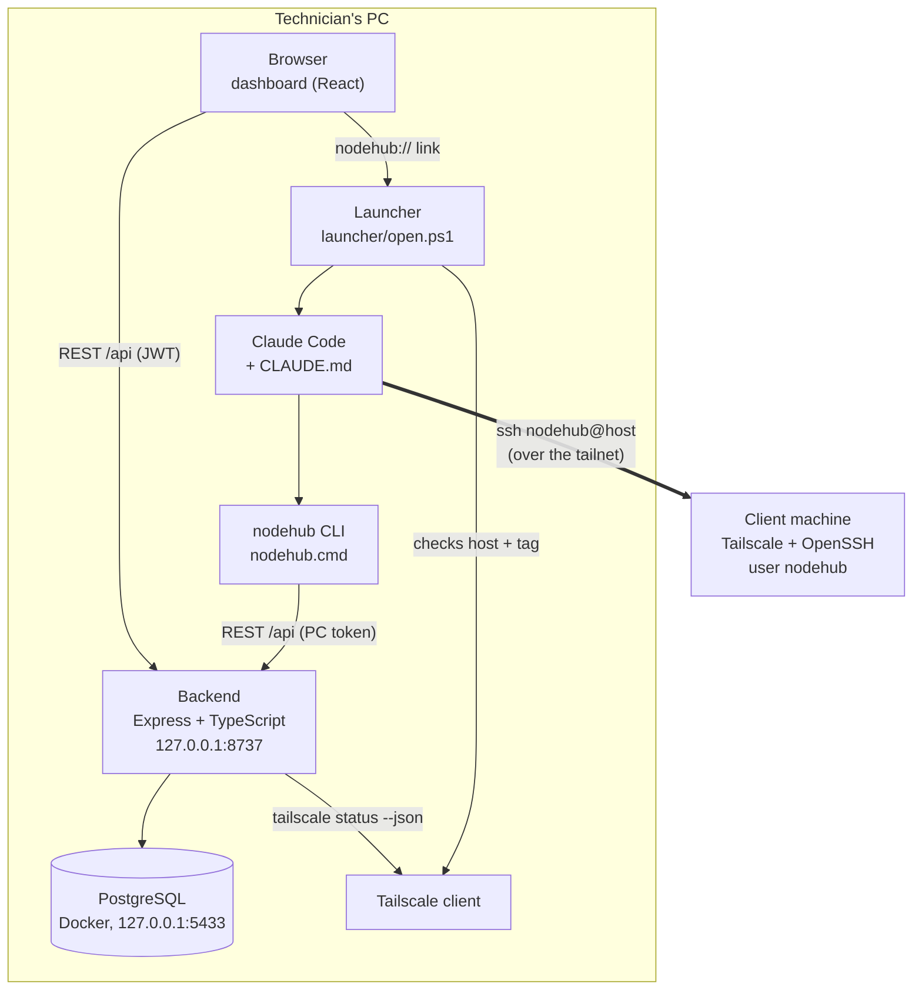
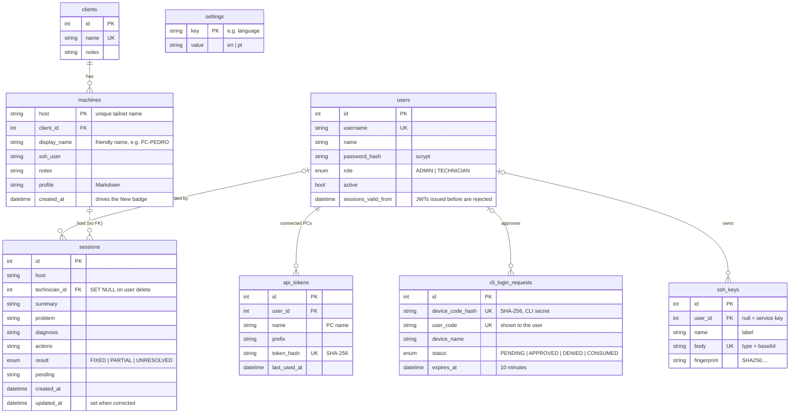
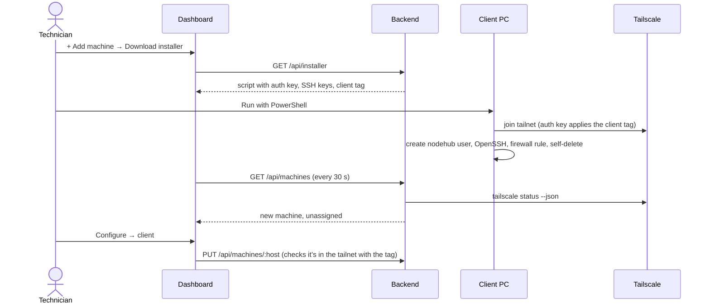
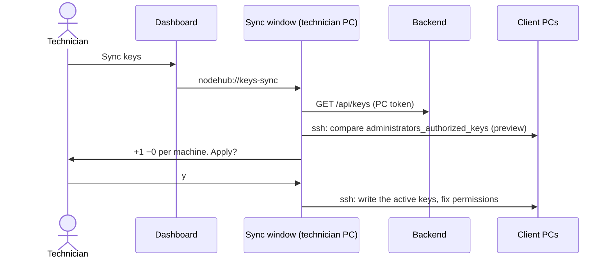
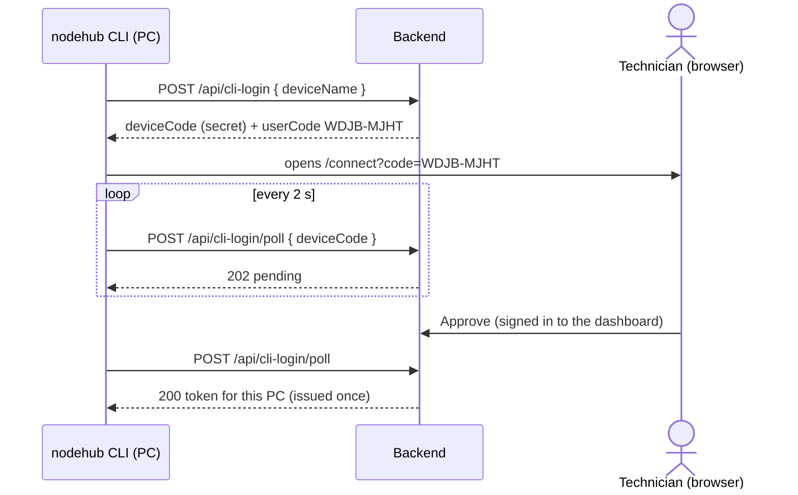

# Architecture

## Components

nodehub runs either on one technician's PC (below) or on an [office server](server.md) that the team
opens at its IP. In both cases Claude Code, the CLI and the launcher run on each technician's PC.



| Component | Location | Role |
|---|---|---|
| **Backend** | `backend/` | REST API, authentication, business rules; serves the built dashboard on the same origin. |
| **Dashboard** | `frontend/` | React single-page app: machines, history, users, team settings, SSH keys, connected PCs, PC approval page. English or Portuguese. |
| **Database** | `docker-compose.yml` | PostgreSQL 17 with Prisma migrations (`backend/prisma/`). |
| **Tailscale** | technician PC | Source of truth for which machines exist and whether they're online. No Tailscale API token is needed. |
| **Launcher** | `launcher/` | Handles `nodehub://` links: `open` validates the link and opens Claude Code with the machine context; `keys-sync` opens the SSH key sync window. |
| **CLI** | `backend/src/cli/` → `nodehub.cmd` | Lets Claude (and technicians) read profiles/history and record or correct sessions; technicians also sync SSH keys with it. |
| **Installer** | `installer/` | Template of the script that prepares client PCs; the backend fills in the secrets. |
| **Claude rules** | `CLAUDE.md` | How Claude runs a helpdesk session and what it may do. |

## Data model



Design choices:

- **Live state is not stored.** Online/offline, IP, OS and last seen come from Tailscale on every
  request, so they're never stale.
- **Machines are keyed by their tailnet name** (first label of the MagicDNS name), which is unique
  even if two clients both have a PC called `SERVIDOR`.
- **Sessions reference the machine by host, not by foreign key**, so removing a machine from the
  dashboard keeps its history; it reappears if the machine is configured again.
- **Clients are matched case-insensitively** when configuring a machine, so "silva bakery" reuses
  "Silva Bakery".
- **Deleting a user keeps their sessions**, with the technician set to null ("deleted user").
- **A friendly name doesn't replace the tailnet name**: SSH and history keep using `host`, so the
  display name can change at any time.
- **SSH keys belong to accounts.** Only keys of active accounts (and service keys) go into installers
  and syncs, so deactivating someone takes their keys off client PCs at the next sync.

## Flows

### Adding a machine



### Opening a session

1. The dashboard builds `nodehub://open?host=…&user=…` (no free text: the client name comes from `nodehub machine`).
2. Windows runs `launcher/open.ps1` with the link.
3. The launcher validates every value **and checks with the local Tailscale client that the host
   exists and carries `CLIENT_TAG`**: a link from an arbitrary web page can't point Claude at
   another machine.
4. It opens Windows Terminal in the repository with `claude "<start message>"`.
5. Claude follows `CLAUDE.md`: `nodehub machine <host>`, SSH, diagnosis, record.

### Syncing SSH keys



The server never connects to client PCs: the window runs on a PC that already has access.

### Connecting a PC (`nodehub login`)



The launcher runs this automatically the first time *Open in Claude* is used on a PC. Only the
hash of the device code is stored; the token is created when the CLI collects it, so it is never
stored in clear text. Requests expire after 10 minutes, and connecting the same PC again replaces
its previous token.

### Authentication

| Credential | Created by | Used by | Lifetime | Can manage users/tokens/password |
|---|---|---|---|---|
| **Dashboard session** (JWT, HS256) | `POST /api/auth/login` | Browser | `JWT_EXPIRES_IN` (12 h), or until the password changes | Yes (by role) |
| **PC token** (`nhk_…`), one per connected PC | Browser approval (`nodehub login`) | CLI / Claude | Until the PC is disconnected | **No** |

Both are sent as `Authorization: Bearer …`. Every request reloads the user, so deactivating a user
cuts all their credentials immediately. PC tokens can only do what Claude needs (read machines and
history, record and correct sessions, update profiles, read the key list): no users, passwords,
tokens, SSH key changes, machine list changes or installer downloads.

### Language

The team language (`settings.language`, set by an admin) is read without signing in
(`GET /api/settings`). The dashboard uses it as its default (each person can override it in the
browser), the CLI prints its messages in it and tells Claude which language to record in, and the
installer and launcher show their messages in it.

## Backend layering

Following [fullstack-ts-standards](https://github.com/MiguelSousa369/fullstack-ts-standards):

```
routes/       HTTP method + path → controller (+ middlewares). No logic.
controllers/  Parse input with Zod, call a service, shape the response.
services/     Business rules and data access (Prisma, Tailscale, ssh).
schemas/      Zod schemas + inferred types: one source of truth for validation and types.
middlewares/  authGuard, sessionOnly, requireRole, localHostOnly (Host/Origin), errorMiddleware.
lib/          Singletons/clients: prisma, tailscale, swagger.
utils/        Stateless helpers: logger, audit log, login throttle, password hashing, HttpError.
docs/         OpenAPI YAML, one file per resource, merged at runtime.
cli/          The nodehub CLI.
```
