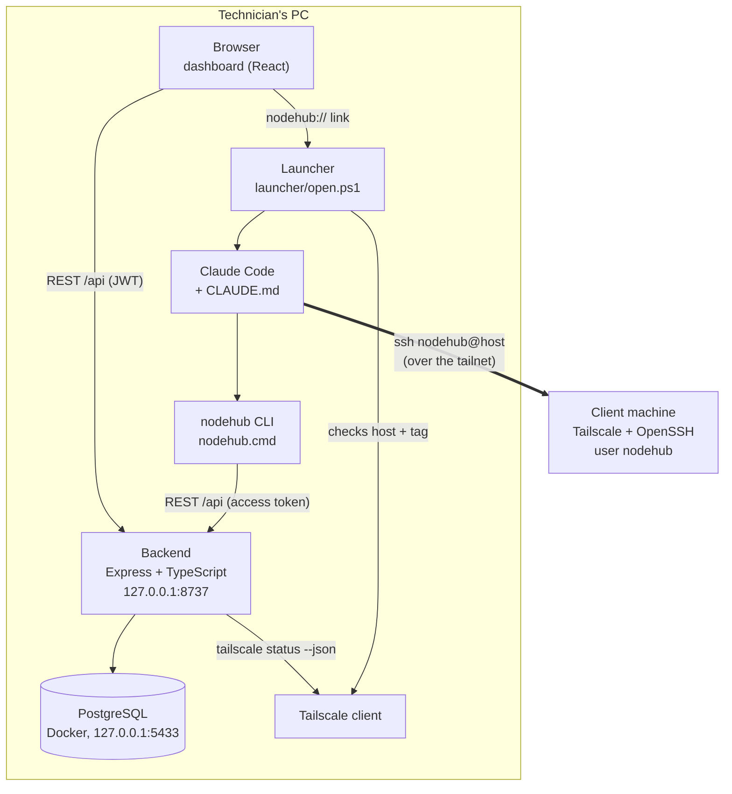
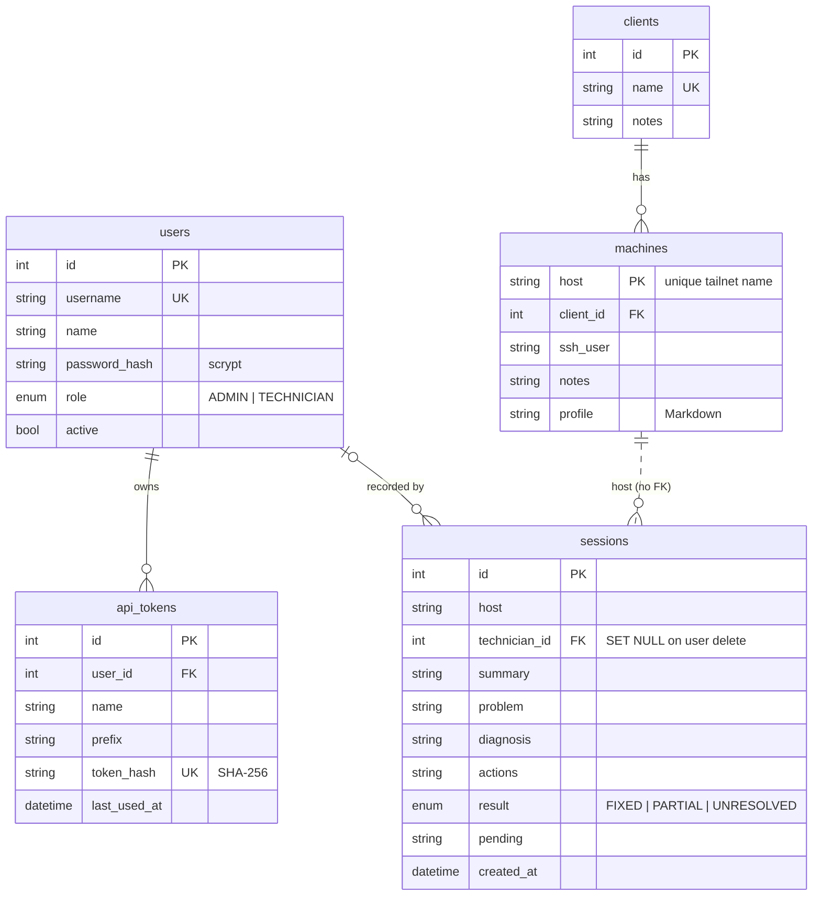
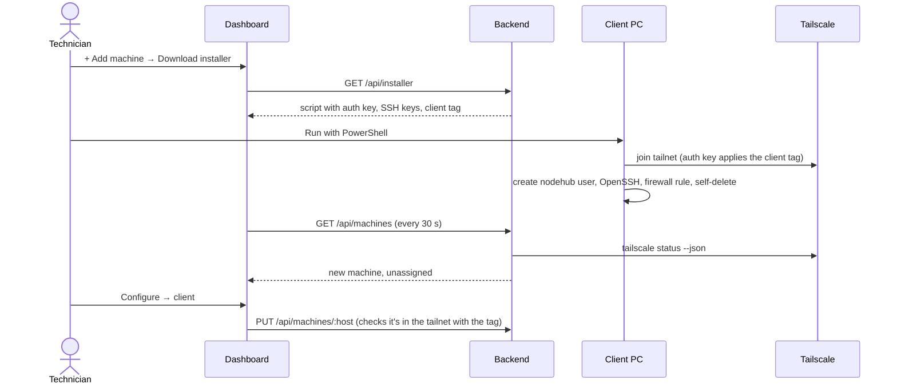

# Architecture

## Components



| Component | Location | Role |
|---|---|---|
| **Backend** | `backend/` | REST API, authentication, business rules; serves the built dashboard on the same origin. |
| **Dashboard** | `frontend/` | React single-page app: machines, history, users, tokens. |
| **Database** | `docker-compose.yml` | PostgreSQL 17 with Prisma migrations (`backend/prisma/`). |
| **Tailscale** | technician PC | Source of truth for which machines exist and whether they're online. No Tailscale API token is needed. |
| **Launcher** | `launcher/` | Handles `nodehub://` links: validates them and opens Claude Code with the machine context. |
| **CLI** | `backend/src/cli/` → `nodehub.cmd` | Lets Claude (and technicians) read profiles/history and record sessions. |
| **Installer** | `installer/` | Template of the script that prepares client PCs; the backend fills in the secrets. |
| **Claude rules** | `CLAUDE.md` | How Claude runs a helpdesk session and what it may do. |

## Data model



Design choices:

- **Live state is not stored.** Online/offline, IP, OS and last seen come from Tailscale on every
  request, so they're never stale.
- **Machines are keyed by their tailnet name** (first label of the MagicDNS name), which is unique
  even if two clients both have a PC called `SERVIDOR`.
- **Sessions reference the machine by host, not by foreign key**, so removing a machine from the
  dashboard keeps its history; it reappears if the machine is configured again.
- **Clients are matched case-insensitively** when configuring a machine, so "silva bakery" reuses
  "Silva Bakery".
- **Deleting a user keeps their sessions**, with the technician set to null ("deleted user").

## Flows

### Adding a machine



### Opening a session

1. The dashboard builds `nodehub://open?host=…&client=…&user=…`.
2. Windows runs `launcher/open.ps1` with the link.
3. The launcher validates every value **and checks with the local Tailscale client that the host
   exists and carries `CLIENT_TAG`**: a link from an arbitrary web page can't point Claude at
   another machine.
4. It opens Windows Terminal in the repository with `claude "<start message>"`.
5. Claude follows `CLAUDE.md`: `nodehub machine <host>`, SSH, diagnosis, record.

### Authentication

| Credential | Created by | Used by | Lifetime | Can manage users/tokens/password |
|---|---|---|---|---|
| **Dashboard session** (JWT) | `POST /api/auth/login` | Browser | `JWT_EXPIRES_IN` (12 h) | Yes (by role) |
| **Access token** (`nhk_…`) | Dashboard → Access tokens | CLI / Claude | Until revoked | **No** |

Both are sent as `Authorization: Bearer …`. Every request reloads the user, so deactivating a user
cuts all their credentials immediately.

## Backend layering

Following [fullstack-ts-standards](https://github.com/MiguelSousa369/fullstack-ts-standards):

```
routes/       HTTP method + path → controller (+ middlewares). No logic.
controllers/  Parse input with Zod, call a service, shape the response.
services/     Business rules and data access (Prisma, Tailscale, ssh).
schemas/      Zod schemas + inferred types: one source of truth for validation and types.
middlewares/  authGuard, sessionOnly, requireRole, localHostOnly, errorMiddleware.
lib/          Singletons/clients: prisma, tailscale, swagger.
utils/        Stateless helpers: logger, password hashing, HttpError.
docs/         OpenAPI YAML, one file per resource, merged at runtime.
cli/          The nodehub CLI.
```
