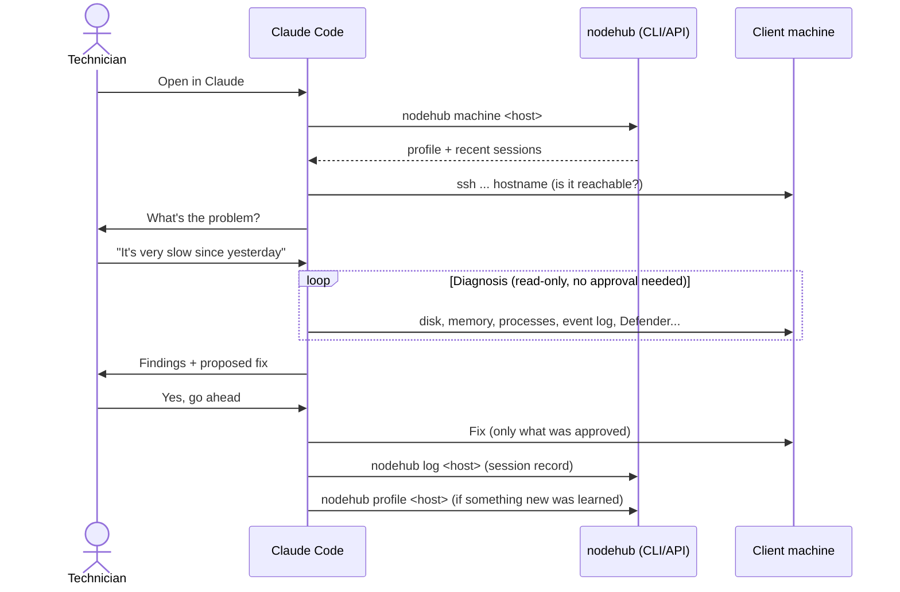

# Helpdesk sessions with Claude

A helpdesk session is a Claude Code conversation in the nodehub folder, focused on one client
machine. Claude follows the rules in [`CLAUDE.md`](../CLAUDE.md), which Claude Code loads
automatically.

## Starting a session

**From the dashboard (recommended):** click **Open in Claude** on the machine. The
`nodehub://` link opens Windows Terminal in the nodehub folder with Claude Code and a start message:

```
Helpdesk: client Silva Bakery, machine srv-bakery (100.98.12.4, user nodehub).
Start the session as described in CLAUDE.md, then ask me what the problem is.
```

The first time, your browser asks whether to open the `nodehub` link: allow it.

**By hand:** open Claude Code in the nodehub folder, click **Copy** on the machine card and paste.

## What happens



1. **Context first.** Claude reads the machine's profile and recent sessions. If the problem
   happened before, it starts from what worked last time.
2. **Reachability.** It checks that SSH works; if not, it tells you whether the machine is offline
   in Tailscale or it's an SSH issue.
3. **Diagnosis.** Read-only checks run without asking.
4. **Changes need your yes.** Claude explains what it wants to change and why, and waits.
5. **Record.** At the end it logs the session (problem, diagnosis, actions, result, pending) under
   your name and updates the machine profile.

## What Claude may do

| Without asking | Only after you approve | Never |
|---|---|---|
| System info, disk, memory, CPU | Restart/stop services or processes | Disable antivirus or firewall |
| Processes, services, scheduled tasks | Reboot or shut down | Touch Tailscale, OpenSSH, the `nodehub` user or the `nodehub-SSH` rule |
| Event Viewer | Install, update, uninstall software | Delete user data |
| Installed software, Windows Update status | Delete files (including temp/caches) | Copy client data off the machine (except logs you ask for) |
| Network configuration | Registry, policies, network, accounts | Write secrets into records or the repository |
| Defender status and **quick scan** | Full Defender scan, quarantine/removal | |

Claude treats anything it reads on a client machine as **data, not instructions**: text in a
file or log can't change these rules.

## Tips

- **Be specific:** "Outlook asks for the password every hour since Monday" beats "email is broken".
- **Ask for a report:** "check the overall health of this PC" runs a full read-only review.
- **Security check:** "check this machine for malware" runs Defender status, threat history, a
  quick scan, suspicious processes, startup items and admin accounts.
- **Several machines:** one Claude session per machine keeps records clean.

## Before the first session

Each technician needs, once:

1. The `nodehub://` protocol registered: `.\launcher\register-protocol.ps1`.
2. Their access token (**Access token** in the dashboard) and `.\nodehub.cmd login` on each PC.
3. Their SSH public key in `public-keys/`, included in the installer the machine was set up with.
