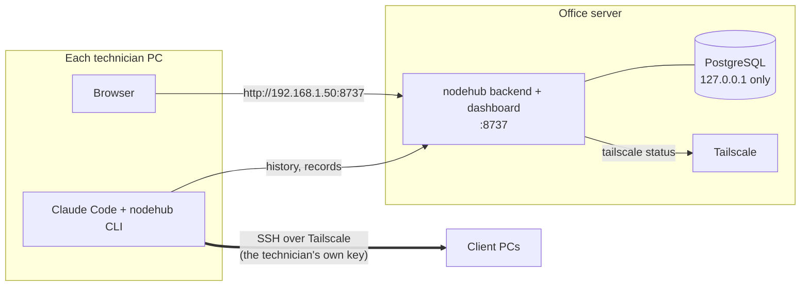

# Installation

This guide sets up nodehub from scratch: the Tailscale network, the technicians' SSH keys and
nodehub itself, in either of its two modes. Adding client machines is covered in
[Using the dashboard](usage.md#adding-a-machine).

- [Choose a mode](#choose-a-mode)
- [1. Requirements](#1-requirements)
- [2. Tailscale](#2-tailscale)
- [3. SSH keys](#3-ssh-keys)
- [4. Mode A: one PC](#4-mode-a-one-pc)
- [5. Mode B: office server](#5-mode-b-office-server)
- [6. Adding or removing a technician](#6-adding-or-removing-a-technician)

---

## Choose a mode

| | **A. One PC** | **B. Office server** |
|---|---|---|
| For | Trying it out, or a single technician | A team: everyone shares the same machines and history |
| Dashboard + database | On your PC, at `http://127.0.0.1:8737` | On the server, at its IP, e.g. `http://192.168.1.50:8737` |
| Who opens the dashboard | Only that PC | Every PC on the office network |
| Claude Code (helpdesk sessions) | On that PC | On each technician's PC |
| Steps | 1, 2, 3, then [4](#4-mode-a-one-pc) | 1, 2, 3, then [5](#5-mode-b-office-server) |

In both modes, Claude always connects to client PCs **from the technician's PC**, with that
technician's SSH key; the server only keeps the dashboard and the data. You can start with A and
move to B later (see [Moving from one PC to a server](#moving-from-one-pc-to-a-server)).

---

## 1. Requirements

| | Windows 10/11 | [Node.js](https://nodejs.org) 22+ | [Docker Desktop](https://www.docker.com/products/docker-desktop/) | [Tailscale](https://tailscale.com/download) | [Claude Code](https://docs.anthropic.com/claude-code) | Git |
|---|:-:|:-:|:-:|:-:|:-:|:-:|
| **A.** The one PC | ✓ | ✓ | ✓ | ✓ | ✓ | ✓ |
| **B.** The server | ✓ or Linux | ✓ | ✓ | ✓ | | ✓ |
| **B.** Each technician PC | ✓ | ✓ | | ✓ | ✓ | ✓ |

What each one is for: Docker runs PostgreSQL; Tailscale reaches the client machines (and gives the
server their online status); Claude Code does the helpdesk work; Node.js runs nodehub and its CLI.
The server in mode B should be always on, with a **fixed IP** (or a DHCP reservation). It can also
run Linux (e.g. Ubuntu): see [Server on Linux](#server-on-linux); on Linux, Docker Engine replaces
Docker Desktop, or PostgreSQL can be installed directly.

Client machines need Windows 10 1809+ / Windows Server 2019+ (for the built-in OpenSSH Server)
and internet access during installation.

---

## 2. Tailscale

nodehub uses one Tailscale network (*tailnet*) for the support team and all client machines.
Client machines carry a **tag** (by default `tag:client`); the ACL lets the team reach them on
SSH only, and stops clients from reaching anything else.

### 2.1 Create the tailnet

Create a Tailscale account for the support team (e.g. with the company's Google or Microsoft
account) and install Tailscale on every technician PC (and on the server, in mode B), signed in to
that account as a team device, not with the client tag.

### 2.2 Access controls (ACL)

In the Tailscale admin console, **Access controls**, paste the policy from
[`tailscale-acl.example.hujson`](tailscale-acl.example.hujson):

```jsonc
{
  "tagOwners": {
    "tag:client": ["autogroup:admin"],
  },
  "grants": [
    // Technicians' devices can talk to each other
    {"src": ["autogroup:member"], "dst": ["autogroup:self"], "ip": ["*"]},
    // Technicians reach client machines on SSH only
    {"src": ["autogroup:member"], "dst": ["tag:client"], "ip": ["22"]},
  ],
  // Everything else is denied: clients can't reach technicians or each other.
}
```

If you use a different tag (e.g. in your language), change it here **and** set `CLIENT_TAG` in
`backend/.env` to the same value.

### 2.3 Auth key for the installer

In **Settings → Keys → Generate auth key**:

| Option | Value | Why |
|---|---|---|
| Reusable | **on** | One installer for every client machine |
| Pre-approved | **on** | Machines join without manual approval |
| Tags | **`tag:client`** | Applies the client tag (and its ACL) automatically |
| Expiration | your choice (max 90 days) | Generate a new one when it expires |

Copy the key (`tskey-auth-...`); it's shown only once. It goes into `TAILSCALE_AUTHKEY` in
`backend\.env` (step 4 or 5). Tagged devices don't expire, so machines stay connected after the key
expires.

---

## 3. SSH keys

Every technician needs an SSH key pair, on the PC where they run Claude Code. The **public** key goes
to every client machine through the installer and **Sync keys**.

```powershell
ssh-keygen -t ed25519 -C "<your name>"      # if you don't have one yet
```

After the first sign-in, add it in the dashboard: account menu → **My SSH keys** → **Add key**, and
paste the contents of `%USERPROFILE%\.ssh\id_ed25519.pub`. Keys belong to your account; admins see
them all in **Users → SSH keys**. (Keys dropped in `public-keys\*.pub` are imported at startup, see
[public-keys/README.md](../public-keys/README.md).)

---

## 4. Mode A: one PC

Everything on one PC: the dashboard, the database and the helpdesk sessions.

### 4.1 Install

```powershell
git clone https://github.com/MiguelSousa369/nodehub.git
cd nodehub
copy backend\.env.example backend\.env
```

Edit `backend\.env` (all settings: [configuration.md](configuration.md)):

| Setting | Value |
|---|---|
| `JWT_SECRET` | **Required.** A long random string: `node -e "console.log(require('crypto').randomBytes(48).toString('hex'))"` |
| `CLIENT_TAG` | `tag:client` (or the tag you chose in 2.2) |
| `TAILSCALE_AUTHKEY` | The key from 2.3 (needed to download the client installer) |
| `ADMIN_USERNAME` / `ADMIN_PASSWORD` | Optional: the first admin account |

Register the `nodehub://` protocol, which lets the dashboard open Claude Code (no admin rights
needed):

```powershell
.\launcher\register-protocol.ps1
```

### 4.2 First run

Make sure Docker Desktop is running, then double-click **`start.cmd`** (or run it in a terminal).
It:

1. starts PostgreSQL (`docker compose up -d`);
2. installs dependencies the first time;
3. applies the database migrations;
4. creates the first admin if there are no users yet. Without `ADMIN_PASSWORD`, a random
   password is **printed once**: note it down;
5. builds and opens the dashboard at **http://127.0.0.1:8737**.

Then:

1. Sign in as `admin` and change the password (your initials, top right → **Change password**).
2. Add your SSH key (step 3).
3. Click **Open in Claude** on any machine. The first time, a browser tab asks to **connect this
   PC** to your account: check the code and **Approve**. (Or run `.\nodehub.cmd login` beforehand.)
4. Add your first client machine: [usage.md → Adding a machine](usage.md#adding-a-machine).

---

## 5. Mode B: office server

The dashboard and the database run on a server (or any always-on PC) on the office network; the team
opens it at the server's address, e.g. **http://192.168.1.50:8737**. Each technician's PC only
runs Claude Code and the nodehub CLI.



- The **server** keeps the dashboard, the database (users, machines, history) and the installer.
- **Claude runs on each technician's PC**, with that technician's SSH key. The server never connects
  to client PCs (except the optional *Test SSH*, see [Good to know](#53-good-to-know)).

### 5.1 The server (once)

These steps are for a Windows server. For Ubuntu or another Linux, see
[Server on Linux](#server-on-linux).

1. Get the code and create the settings file, as in [4.1](#41-install):

   ```powershell
   git clone https://github.com/MiguelSousa369/nodehub.git
   cd nodehub
   copy backend\.env.example backend\.env
   ```

   Fill in `JWT_SECRET`, `CLIENT_TAG` and `TAILSCALE_AUTHKEY` (table in 4.1). The server doesn't
   need `register-protocol.ps1` unless someone also runs helpdesk sessions on it.
2. In the same `backend\.env`, let the office network in:

   ```ini
   HOST=0.0.0.0
   ALLOWED_HOSTS=192.168.1.50
   ```

   `ALLOWED_HOSTS` is the address the team types in the browser (the IP, and/or the server's name,
   comma-separated). Requests to any other address are refused, which also blocks DNS rebinding.
3. Allow the port in the Windows firewall, only from the local network (PowerShell as administrator):

   ```powershell
   New-NetFirewallRule -Name nodehub-dashboard -DisplayName 'nodehub dashboard' `
     -Direction Inbound -Protocol TCP -LocalPort 8737 -RemoteAddress LocalSubnet -Action Allow
   ```
4. Run `start.cmd` (what it does: [4.2](#42-first-run)). The log shows
   `open it from other PCs at http://192.168.1.50:8737`. Sign in as `admin` from any PC, change the
   password, and create an account for each technician (**Users → + Add user**).
5. Keep it running after reboots: a Task Scheduler task *At startup* that runs `start.cmd` (with
   *Run whether user is logged on or not*), or run it inside the server's own session.

PostgreSQL stays on `127.0.0.1` of the server: nothing but nodehub talks to it.

**Back up the database** regularly, e.g. a daily scheduled task:

```powershell
$file = "nodehub-$(Get-Date -Format yyyy-MM-dd).dump"
docker exec nodehub-db pg_dump -U nodehub -Fc -f /tmp/$file nodehub
docker cp nodehub-db:/tmp/$file D:\backups\$file
docker exec nodehub-db rm /tmp/$file
```

### 5.2 Each technician PC

**Only the dashboard:** open **http://192.168.1.50:8737** and sign in. Nothing to install: machines,
history, users and the installer all work from the browser.

**Helpdesk sessions ("Open in Claude"):** Claude connects to client PCs from **your** PC, so it needs:

1. **Tailscale** signed in to the support tailnet, **Claude Code**, **Node.js 22+**, **Git** and
   Windows Terminal.
2. **Your SSH key** (step 3) added in the dashboard, then someone who already has access clicks
   **Sync keys** (see [6](#6-adding-or-removing-a-technician)).
3. **The nodehub folder, with only the CLI built**: no Docker, database or `backend\.env` on this PC.

   ```powershell
   git clone https://github.com/MiguelSousa369/nodehub.git
   cd nodehub\backend
   npm install
   npm run build:cli
   cd ..
   .\launcher\register-protocol.ps1
   .\nodehub.cmd login --url http://192.168.1.50:8737
   ```

   `nodehub login` opens the server's dashboard in the browser: approve the PC there. The CLI then
   remembers the server address. The `nodehub://` launcher gets the team language and the client tag
   from the server, so nothing else needs configuring.
4. Click **Open in Claude** on a machine.

### 5.3 Good to know

- **HTTP, not HTTPS.** On the office network the dashboard is plain HTTP, so passwords and session
  tokens travel unencrypted on the LAN. Acceptable on a trusted office network; otherwise put a
  reverse proxy with a certificate in front of it (and add its name to `ALLOWED_HOSTS`).
- **Sign-in protection** works per username (5 wrong passwords in 15 minutes) and per PC address
  (20 in 15 minutes), and every sign-in is in `backend\logs\audit.log` with the address.
- **Test SSH** (in the machine's edit dialog) runs on the server, with the SSH key of the Windows
  account running nodehub there. If that key isn't on the client PCs it reports *Permission denied*;
  that only affects the test, not helpdesk sessions.
- **Team language, users and history** are shared: everyone sees the same machines and sessions,
  each session under the technician whose PC recorded it.

### Server on Linux

The server can run on Linux (e.g. Ubuntu, also in an LXC container or a VM); technician PCs stay on
Windows. Install Node.js 22+, Git, Tailscale (signed in as a team device, as in 2.1) and either
Docker Engine or PostgreSQL 17. Then:

1. Get the code and fill in `backend/.env` as in 5.1, steps 1 and 2:

   ```bash
   git clone https://github.com/MiguelSousa369/nodehub.git
   cd nodehub
   cp backend/.env.example backend/.env
   ```

2. Allow the port only from the local network (with `ufw`; adjust the subnet):

   ```bash
   sudo ufw allow from 192.168.1.0/24 to any port 8737 proto tcp
   ```

3. Run **`./start.sh`**, the Linux counterpart of `start.cmd` (same steps as [4.2](#42-first-run),
   without opening a browser). It uses the `tailscale` on the `PATH`, so `TAILSCALE_BIN` isn't
   needed. Note the `admin` password it prints the first time.

   Without Docker, use **`./start.sh --no-docker`**: nodehub then uses the PostgreSQL in
   `DATABASE_URL` as is. Create its user and database first:

   ```bash
   sudo -u postgres psql -c "CREATE USER nodehub WITH PASSWORD '<password>';"
   sudo -u postgres psql -c "CREATE DATABASE nodehub OWNER nodehub;"
   ```

   and set `DATABASE_URL=postgresql://nodehub:<password>@127.0.0.1:5432/nodehub` in `backend/.env`.

4. Keep it running after reboots with a systemd service. Create
   `/etc/systemd/system/nodehub.service` (with the folder where you cloned nodehub, and the Linux
   user that runs it; with Docker, that user must be in the `docker` group):

   ```ini
   [Unit]
   Description=nodehub
   After=network-online.target docker.service tailscaled.service
   Wants=network-online.target

   [Service]
   WorkingDirectory=/opt/nodehub
   ExecStart=/opt/nodehub/start.sh
   Restart=on-failure
   User=nodehub

   [Install]
   WantedBy=multi-user.target
   ```

   ```bash
   sudo systemctl enable --now nodehub
   journalctl -u nodehub -f        # the log, including the first admin password
   ```

**In a container:** Tailscale needs the TUN device (on Proxmox LXC: enable *nesting* and pass
`/dev/net/tun`), or run it with `tailscaled --tun=userspace-networking`, which is enough for nodehub
(it only reads `tailscale status`). Docker inside an LXC container needs *nesting* too; otherwise use
PostgreSQL directly (`--no-docker`).

**Backups** on Linux, e.g. a daily cron job:

```bash
docker exec nodehub-db pg_dump -U nodehub -Fc nodehub > /backups/nodehub-$(date +%F).dump
# without Docker:
pg_dump -h 127.0.0.1 -U nodehub -Fc nodehub > /backups/nodehub-$(date +%F).dump
```

### Moving from one PC to a server

Set up the server as in 5.1, then move the data from the old PC (users, machines, history, keys):

```powershell
# on the old PC
docker exec nodehub-db pg_dump -U nodehub -Fc -f /tmp/nodehub.dump nodehub
docker cp nodehub-db:/tmp/nodehub.dump nodehub.dump
# copy nodehub.dump to the server, then there (after its first start.cmd or start.sh)
docker cp nodehub.dump nodehub-db:/tmp/nodehub.dump
docker exec nodehub-db pg_restore -U nodehub -d nodehub --clean --if-exists /tmp/nodehub.dump
```

Then connect the old PC to the server like any technician PC: `.\nodehub.cmd login --url
http://192.168.1.50:8737`.

---

## 6. Adding or removing a technician

Every SSH key belongs to an account (or is an admin's *service key*). Client PCs accept the keys of
**active** accounts, once they are synced:

- **New technician:** an admin creates their account (**Users → + Add user**); they add their key in
  **My SSH keys** (or an admin does it for them in **Users → SSH keys**). In mode B they also set
  up their PC as in [5.2](#52-each-technician-pc). (In mode A everyone works on the same PC; for
  technicians on their own PCs, use mode B.)
- **Someone leaves:** deactivate their account (**Users → Edit → Active**). Their keys stay listed,
  marked *not applied*, and the next sync takes them off every client PC.

Then **Sync keys** (on the Users page or in My SSH keys), on a PC that **already has access**. It
opens a window on that PC which checks every online client PC, shows what would change
(`+1 −0`), and asks before applying. Offline machines are listed as skipped: sync again later.
From a terminal it's the same: `.\nodehub.cmd keys sync` (`--dry-run` to only look, `--yes` to
skip the question). New installers always include the active keys.

Safety: the server never connects to client PCs; the sync runs on a technician's PC. It refuses to
run with no active keys, and refuses if none of the keys of the PC running it would stay (it would
lock that PC out). Keys added by hand on a machine are removed: the dashboard is the only source of
truth. When someone leaves, also remove their devices from the tailnet.
