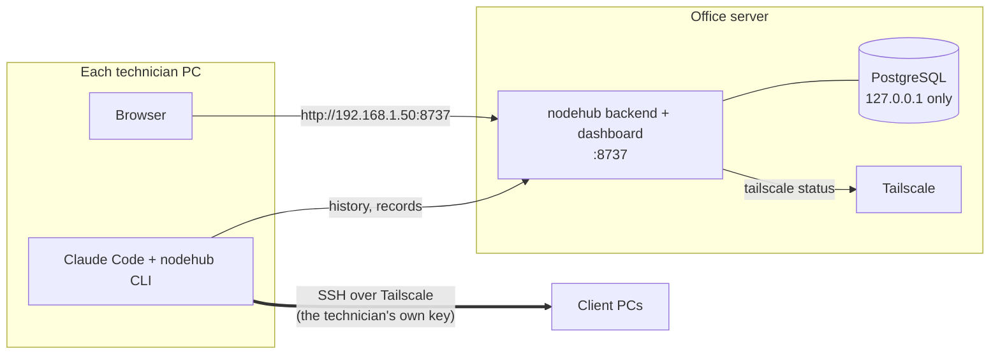

# Running nodehub on an office server

By default nodehub runs on one technician's PC and only that PC can open it. To share it with the
whole team, run it on a server (or any always-on PC) on the office network, and open the dashboard
at the server's address, e.g. **http://192.168.1.50:8737**.



- The **server** keeps the dashboard, the database (users, machines, history) and the installer.
- **Claude runs on each technician's PC**, with that technician's SSH key. The server never connects
  to client PCs (except the optional *Test SSH*, see below).

---

## 1. The server (once)

**Needs:** Windows, always on, with a **fixed IP** (or a DHCP reservation) on the office network;
Docker Desktop, Node.js 20+, Git, and **Tailscale signed in to the support tailnet** as a team device
(not with the client tag). nodehub reads machine status from it.

1. Install nodehub as in [installation.md](installation.md) (clone, `backend\.env`, `start.cmd`).
2. In `backend\.env`, let the office network in:

   ```ini
   HOST=0.0.0.0
   ALLOWED_HOSTS=192.168.1.50
   ```

   `ALLOWED_HOSTS` is the address the team types in the browser (the IP, and/or the server's name,
   comma-separated). Requests to any other address are refused, which also blocks DNS rebinding.
3. Allow the port in the Windows firewall, only from the local network (PowerShell as administrator):

   ```powershell
   New-NetFirewallRule -Name nodehub-dashboard -DisplayName 'nodehub dashboard' `
     -Direction Inbound -Protocol TCP -LocalPort 8737 -RemoteAddress LocalSubnet -Action Allow
   ```
4. Run `start.cmd`. The log shows `open it from other PCs at http://192.168.1.50:8737`.
5. Keep it running after reboots: a Task Scheduler task *At startup* that runs `start.cmd` (with
   *Run whether user is logged on or not*), or run it inside the server's own session.
6. Each technician adds their **public** SSH key in the dashboard (account menu → **My SSH keys**);
   admins see them all in **Users → SSH keys**. The installer adds them to new client PCs, and
   **Sync keys** to existing ones (see [Adding or removing a technician](#adding-or-removing-a-technician)).
   Keys left in `public-keys\*.pub` from an older setup are imported automatically.

PostgreSQL stays on `127.0.0.1` of the server: nothing but nodehub talks to it.

**Back up the database** regularly, e.g. a daily scheduled task:

```powershell
docker exec nodehub-db pg_dump -U nodehub nodehub > D:\backups\nodehub-$(Get-Date -Format yyyy-MM-dd).sql
```

---

## 2. Each technician PC

### Only the dashboard

Open **http://192.168.1.50:8737** and sign in with the account an admin created for you
(**Users → Add user**). Nothing to install: machines, history, users and the installer all work
from the browser.

### Helpdesk sessions ("Open in Claude")

Claude connects to client PCs from **your** PC, so it needs:

1. **Tailscale**, signed in to the support tailnet as a team device.
2. **Claude Code**, **Node.js 20+**, **Git** and Windows Terminal.
3. **An SSH key** (`ssh-keygen -t ed25519`): add the `.pub` in the dashboard (account menu →
   **My SSH keys**), then someone who already has access clicks **Sync keys** (next section).
4. **The nodehub folder**, with only the CLI built (no database or `.env` needed on this PC):

   ```powershell
   git clone https://github.com/MiguelSousa369/nodehub.git
   cd nodehub\backend
   npm install
   npm run build:cli
   cd ..
   .\launcher\register-protocol.ps1
   .\nodehub.cmd login --url http://192.168.1.50:8737
   ```

   `nodehub login` opens the server's dashboard in the browser: approve the PC there. The CLI then
   remembers the server address. The `nodehub://` launcher gets the team language and the client tag
   from the server, so nothing else needs configuring.
5. Click **Open in Claude** on a machine.

---

## Adding or removing a technician

Every SSH key belongs to an account (or is an admin's *service key*). Client PCs accept the keys of
**active** accounts, once they are synced:

- **New technician:** they add their key in **My SSH keys** (or an admin does it for them in
  **Users → SSH keys**).
- **Someone leaves:** deactivate their account (**Users → Edit → Active**). Their keys stay listed,
  marked *not applied*, and the next sync takes them off every client PC.

Then **Sync keys** (on the Users page or in My SSH keys), on a PC that **already has access**. It
opens a window on that PC which checks every online client PC, shows what would change
(`+1 −0`), and asks before applying. Offline machines are listed as skipped: sync again later.
From a terminal it's the same: `.\nodehub.cmd keys sync` (`--dry-run` to only look, `--yes` to
skip the question).

Safety: the server never connects to client PCs; the sync runs on a technician's PC. It refuses to
run with no active keys, and refuses if none of the keys of the PC running it would stay (it would
lock that PC out). Keys added by hand on a machine are removed: the dashboard is the only source of
truth. When someone leaves, also remove their devices from the tailnet.

---

## Good to know

- **HTTP, not HTTPS.** On the office network the dashboard is plain HTTP, so passwords and session
  tokens travel unencrypted on the LAN. Acceptable on a trusted office network; otherwise put a
  reverse proxy with a certificate in front of it (and add its name to `ALLOWED_HOSTS`).
- **Sign-in protection** works per username (5 wrong passwords in 15 minutes) and per PC address
  (20 in 15 minutes), and every sign-in is in `backend\logs\audit.log` with the address.
- **Test SSH** (in the machine's edit dialog) runs on the server, with the SSH key of the Windows
  account running nodehub there. If that key isn't on the client PCs it reports *Permission denied*;
  that only affects the test, not helpdesk sessions.
- **Team language, users and history** are shared: everyone sees the same machines and sessions,
  each session under the technician whose PC recorded it.
